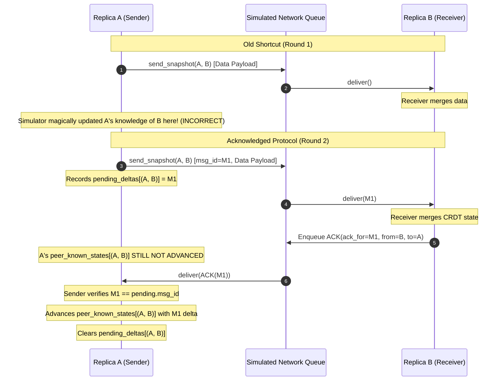

# PS-39: Acknowledged Delta Synchronization Specification & Technical Report

## 1. Executive Summary & Problem Context

In distributed offline-first data stores utilizing Conflict-free Replicated Data Types (CRDTs), state synchronization between disconnected peers is crucial. 

In the Round 1 prototype of the PS-39 system, delta mode relied on a simulation shortcut: when a receiver merged an incoming delta snapshot, the simulator immediately updated `peer_known_states[(sender, receiver)]`. This assumed instant, omniscient, and centralized knowledge that does not exist in real physical networks. In an actual offline-first or asynchronous network, the sender cannot assume that the receiver has received or processed a payload until it receives an explicit network acknowledgement (ACK).

This document details the design, implementation, verification, and demonstration of the **Acknowledged Delta Synchronization Protocol** for PS-39, replacing the simulation shortcut with explicit network acknowledgements, at-most-once unacknowledged deltas, safe retry mechanisms, and separated network metrics.

---

## 2. Protocol Architecture & Invariants

### 2.1 The Old Shortcut vs. The Acknowledged Protocol



### 2.2 Message Structure & Typing

Every packet in the network is represented by a strongly typed `Message` record:

```python
@dataclass(frozen=True)
class Message:
    sender: str             # Originating replica ID
    receiver: str           # Destination replica ID
    payload: str            # Serialized UTF-8 JSON payload
    msg_id: str = ""        # Unique message identifier
    msg_type: str = "data"  # Type discriminator: 'data' or 'ack'
    ack_for: str = ""       # Targeted message ID when msg_type == 'ack'
```

- **Data Message:** Carries CRDT state diffs or full snapshots. Carries a unique `msg_id`.
- **ACK Message:** Carries `msg_type = "ack"` and references `ack_for = msg_id`. Its payload is serialized JSON containing the acknowledgement metadata.
- **Message Size (`size_bytes`):** Calculated as `len(self.payload.encode("utf-8"))`, representing serialized payload bytes without synthetic transport header padding.

### 2.3 Unique Message ID Generation

Message IDs are deterministically generated per replica pair with sequential numbering and a short cryptographic entropy suffix:

$$\text{msg\_id} = \text{"msg-}\{sender\}\text{--}\{receiver\}\text{--}\{\text{seq}\}\text{--}\{\text{uuid4()[:8]}\}"$$

This guarantees uniqueness across trials and prevents ID collision across different phases of the simulation.

### 2.4 State Bookkeeping & Invariants

For each pair of replicas $(S, R)$ where $S \ne R$:

1. **`peer_known_states[(S, R)]` (Replica Instance):**
   - Represents the latest CRDT state that sender $S$ has received confirmation that receiver $R$ has successfully merged.
   - **Invariant 1:** $S$'s known state for $R$ monotonically grows and can **only** advance upon receiving a valid, matching ACK from $R$.
   - **Invariant 2:** Known state is advanced by merging **only the exact delta state** associated with the acknowledged message ID, never $S$'s latest local snapshot.

2. **`pending_deltas[(S, R)]` (PendingDelta Instance):**
   - Holds at most one active unacknowledged logical delta:
     ```python
     @dataclass
     class PendingDelta:
         msg_id: str
         sender: str
         receiver: str
         delta_state: dict[str, Any]
         payload: str
     ```
   - **Invariant 3:** While a delta is pending for $(S, R)$, no newer delta is calculated for $(S, R)$. Subsequent broadcast rounds resend the unacknowledged delta until an ACK is received.
   - **Invariant 4:** Unacknowledged retries reuse the original `msg_id` and serialized `payload`.

---

## 3. Detailed Operational Semantics

### 3.1 Transmitting a Delta Snapshot

When `send_snapshot(sender, receiver)` executes in delta mode:

1. **Partition Check:** If `_groups[sender] != _groups[receiver]`, transmission is blocked immediately; returns `False`.
2. **Pending Check (Retry Path):**
   - If `pending_deltas.get((sender, receiver))` exists:
     - Check if a data packet with `msg_id == pending.msg_id` is already waiting in `self.queue`.
     - If already in queue: return `False` (prevents queue bloat and uncontrolled packet flooding).
     - If not in queue (e.g., dropped or delivered without an ACK yet returned): re-enqueue the message with the original `msg_id` and `payload`. Increment `messages_sent` and `bytes_transmitted`. Return `True`.
3. **Fresh Delta Path:**
   - If no pending delta exists: compute delta between `replicas[sender]` and `peer_known_states[(sender, receiver)]`.
   - If all CRDT component deltas are empty: return `False` (skips sending unchanged state).
   - If delta contains updates:
     - Generate a new `msg_id`.
     - Record `pending_deltas[(sender, receiver)] = PendingDelta(...)`.
     - Enqueue `Message(..., msg_id=msg_id, msg_type="data")`.
     - Increment `messages_sent` and `bytes_transmitted`. Return `True`.

### 3.2 Receiving Data & Generating ACKs

When `deliver(index)` processes a `data` message:

1. Partition check: if partitioned, delivery returns `False` and packet remains in queue.
2. Receiver CRDT merge: `self.replicas[message.receiver].merge_state(incoming_state)`.
3. Metrics update:
   - Record `merge_latencies_ms` (measuring only the local CRDT merge execution time).
   - Increment `messages_delivered` and `bytes_delivered`.
4. In delta mode:
   - Generate an ACK packet:
     `Message(sender=message.receiver, receiver=message.sender, msg_type="ack", ack_for=message.msg_id, payload=ack_payload)`.
   - Enqueue the ACK into `self.queue`.
   - Increment `ack_messages_sent` and `ack_bytes_transmitted`.
   - **Crucial:** Sender's `peer_known_states` is NOT modified here.

### 3.3 Validating & Processing ACKs

When `deliver(index)` processes an `ack` message:

1. Partition check: if partitioned, ACK delivery is blocked (returns `False`).
2. ACK metrics update: increment `ack_messages_delivered` and `ack_bytes_delivered`.
3. Identification:
   - `orig_sender = ack_message.receiver`
   - `orig_receiver = ack_message.sender`
   - `pair = (orig_sender, orig_receiver)`
4. Validation checks:
   - If `pair not in self.pending_deltas`:
     - **Action:** Safely discard (stale ACK, duplicate ACK, or unexpected ACK). Do not regress or alter state.
   - If `self.pending_deltas[pair].msg_id != ack_message.ack_for`:
     - **Action:** Safely discard (older ACK or mismatched ID). Do not clear pending delta.
5. Commit:
   - `self.peer_known_states[pair].merge_state(pending.delta_state)`
   - `del self.pending_deltas[pair]`
   - Return `True`.

### 3.4 Fault Handling Matrix

| Fault Scenario | Simulator Behavior | Guarantee / Result |
|---|---|---|
| **Data Packet Dropped** | Data packet removed from queue. Receiver never receives it; no ACK sent. `pending_deltas` remains active. | Next `broadcast_round()` retransmits the same delta with identical `msg_id` and `payload`. |
| **ACK Packet Dropped** | Receiver merged data and queued ACK; ACK is dropped. Sender never receives ACK. | Next `broadcast_round()` retransmits data. Receiver merges idempotently and generates a fresh ACK. Sender receives fresh ACK and advances known state. |
| **Duplicate Data Packet** | Queue contains duplicate copies of the same data message. | Receiver merges state idempotently; emits an ACK for each copy. First ACK clears pending delta; second ACK is safely ignored as stale. |
| **Duplicate ACK Packet** | Queue contains duplicate copies of an ACK. | First delivery advances `peer_known_states` and clears `pending_deltas`. Second delivery finds no matching pending delta and is discarded without effect. |
| **Reordered ACKs** | An older delayed ACK arrives after a newer delta has been dispatched. | `pending.msg_id != ack.ack_for` check rejects the older ACK. Newer pending delta is preserved; known state is not corrupted. |
| **Network Partition** | Links severed between replica groups. | Data and ACK packets cannot cross partition boundaries. Messages wait in queue until network heals. |

---

## 4. Separated Metrics Accounting

To preserve backward compatibility with existing benchmarks, tools, and dashboards, data traffic and ACK traffic are measured separately:

| Metric Name | Category | Description |
|---|---|---|
| `messages_sent` | Data | Number of data packets enqueued (includes retransmissions). |
| `messages_delivered` | Data | Number of data packets successfully delivered and merged. |
| `bytes_transmitted` | Data | Serialized UTF-8 payload bytes of data messages enqueued. |
| `bytes_delivered` | Data | Serialized UTF-8 payload bytes of data messages delivered. |
| `average_merge_latency_ms` | Timing | Mean time spent executing CRDT `merge_state()` on data messages. |
| `ack_messages_sent` | ACK | Number of ACK packets enqueued. |
| `ack_messages_delivered` | ACK | Number of ACK packets delivered. |
| `ack_bytes_transmitted` | ACK | Serialized UTF-8 payload bytes of ACK messages enqueued. |
| `ack_bytes_delivered` | ACK | Serialized UTF-8 payload bytes of ACK messages delivered. |

*Note:* In full-state mode, all ACK metrics remain strictly zero.

---

## 5. Failure Injection & Test Utilities

The simulator provides built-in, lightweight failure injection mechanisms:

- `drop_message(index: int) -> Message`: Discards a specific queued message.
- `drop_first_ack() -> Message | None`: Discards the first ACK in the queue.
- `drop_ack(ack_for: str) -> bool`: Discards the ACK matching a specific message ID.
- `drop_random_messages(p_data: float, p_ack: float, rng) -> int`: Probabilistically drops data and ACK packets with deterministic seeded random streams.
- `all_deltas_acknowledged() -> bool`: Returns `True` when all in-flight deltas across all pairs have been acknowledged.

---

## 6. Verification & Experimental Results

### 6.1 Test Suite Verification

The full test suite was executed locally on Windows:

```powershell
python -m pytest tests -v
```

**Results:**
- **Baseline suite:** 51 passed.
- **New acceptance tests (`test_acknowledged_delta_sync.py`):** 8 passed.
- **Total test suite:** **59 passed in 3.18 seconds**.

### 6.2 Acceptance Tests Summary

1. **Test A (Happy-Path Acknowledged Delta Sync):**
   - Partitioned network with independent G-Counter and OR-Set updates.
   - Verified receiving replica merges data while sender's peer-known state remains strictly at baseline.
   - Verified sender advances peer-known state only upon receiving the matching ACK.
   - Reconnected and verified full 5-replica convergence.
2. **Test B (Lost ACK & Retry):**
   - Data delivered; ACK dropped. Sender peer-known state did not advance.
   - Subsequent broadcast retried the identical message ID and payload.
   - Successful delivery of retry and ACK cleared pending delta; subsequent broadcast sent 0 messages.
3. **Test C (Duplicate ACK Safety):**
   - Duplicate ACK processed; verified safe disposal, no state regression, and accurate ACK metric accounting.
4. **Test D (Stale, Unknown, and Mismatched ACKs):**
   - Tested bogus IDs, wrong peer origin, stale ACK arrivals, and older ACK arriving during a newer pending delta.
   - Proved newer unsent changes are never accidentally marked as acknowledged.
5. **Test E (Partition Blocking & Recovery):**
   - Verified cross-partition delivery is rejected for both data and ACKs.
   - Verified that healing partitions restores full delivery and anti-entropy convergence.
6. **Test F (Seeded Randomized Loss Stress - 60 Trials):**
   - 60 independent trials (seeds 30000–30059) under 15% data loss and 15% ACK loss.
   - Bound: 100 recovery rounds.
   - **Convergence rate:** **100.00% (60/60 trials converged)**.
   - **Worst recovery rounds:** 11 rounds (well below the 100-round bound).
   - Zero queued messages or pending deltas at trial termination.
7. **Full-State Compatibility:**
   - Full-state synchronization verified; zero ACK traffic generated; identical metrics and convergence semantics preserved.

---

## 7. Streamlit Dashboard Live Demonstration Procedure

To demonstrate the live system to evaluators:

1. Launch the interactive dashboard:
   ```powershell
   python -m streamlit run src/dashboard.py
   ```
2. **Step 1: Normal Delta Synchronization**
   - Select **Delta synchronisation** in the sidebar.
   - Choose replica `r1` and add a task (e.g., `"Deploy Rover"`).
   - Click **Broadcast round**: observe 4 queued `DATA` messages.
   - Click **Deliver all reachable**: observe data messages delivered, 4 `ACK` messages generated, and all delivered. `Pending deltas` shows `0`.
3. **Step 2: Dropped ACK & Automatic Retry**
   - Choose replica `r1` and increment counter by `5`.
   - Click **Broadcast round**: observe queued data message from `r1` to peer replicas.
   - Select message index `0` and click **Deliver selected message**: receiver merges update; an `ACK` is queued.
   - Click **Drop first queued ACK**: the ACK is dropped!
   - Observe that `r1`'s peer-known state has NOT updated and `Pending deltas` shows active pending deltas.
   - Click **Broadcast round**: observe that `r1` retries the exact same data message!
4. **Step 3: Successful Acknowledged Recovery**
   - Click **Deliver all reachable**: the retried message and its new ACK are delivered.
   - `Pending deltas` drops to `0`. All replicas converge.
5. **Step 4: Partition & Heal**
   - Click **Split network**: groups `[r1, r2]` and `[r3, r4, r5]`.
   - Make edits in both groups. Click **Broadcast + deliver**.
   - Notice cross-group updates are blocked.
   - Click **Heal network**, then **Broadcast + deliver**: all replicas converge.
   - Review the **Merge performance** section: observe distinct counts for **Data delivered** and **ACKs delivered**.

---

## 8. Optional Developer Tooling (Prune Gateway)

In accordance with competition guidelines, the core PS-39 data store runs 100% locally and offline without external dependencies. 

For developers interested in validating OpenRouter access via the Prune proxy gateway (`https://api.withprune.com/v1/proxy/openrouter/chat/completions`), a standalone developer utility is provided at `scripts/prune_smoke_test.py`:

- **Security:** Credentials must never be hardcoded. The script reads exclusively from the `PRUNE_API_KEY` environment variable.
- **Execution:**
  ```powershell
  # If key is available in your secure environment:
  $env:PRUNE_API_KEY = "your-revoked-replacement-key"
  python scripts/prune_smoke_test.py
  ```
- If the environment variable is unset, the script safely reports `[STATUS: UNVERIFIED]` and exits without error.

---

## 9. Conclusion

The Acknowledged Delta Synchronization protocol successfully eliminates the centralized knowledge shortcut from PS-39 Round 1. By treating acknowledgements as first-class, partition-sensitive network messages, enforcing strict per-peer pending invariants, and providing automatic retry capabilities, the store achieves true decentralized anti-entropy with provable empirical convergence across all tested schedules and failure rates.
